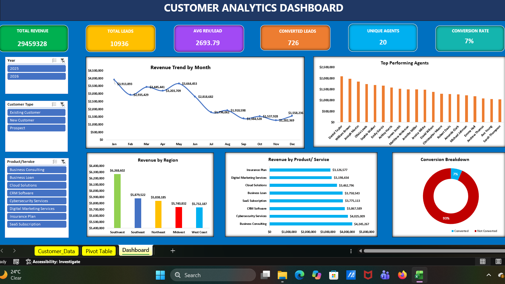

# 📊 Customer Analytics Dashboard

An interactive Excel Dashboard to track Revenue, Leads & Conversion Performance in one view.

## 📸 Preview

## 🎯 Key Insights
- Total Revenue: 29.4M | Total Leads: 10,936 | Conversion Rate: 7%
- Avg Revenue per Lead: 2,693.79
- Revenue Trend by Month
- Top Performing Agents
- Revenue by Region & Product/Service

## ✨ Features
- One-Page Interactive Dashboard
- 6 KPI Cards for Quick Overview
- Slicers for Year, Customer Type & Product/Service
- Pivot Charts & Conversion Breakdown

## 🛠️ Tools Used
- Microsoft Excel | Pivot Tables & Charts | Slicers

## 🚀 How to Use
1. Download `Customer_Analytics.xlsm`
2. Open in Excel & use Slicers on the left to filter data

## 👩‍💻 Created By
**Radhika Gagare** | Aspiring Data Analyst
